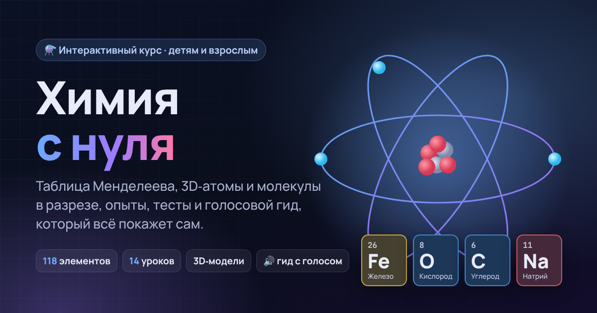

# Химия с нуля

Интерактивный курс химии для детей и взрослых: таблица Менделеева, 3D‑модели атомов, молекул и кристаллов в разрезе, симуляции, тренажёры и тесты.

## Что внутри

- **Таблица Менделеева** на главной: 118 элементов, поиск, 8 раскрасок (семейства, состояние, блоки, электроотрицательность, масса, плотность, температура плавления, год открытия). Клик по элементу открывает страницу с 3D‑атомом (ядро из протонов и нейтронов, электроны на оболочках, разрез электронного облака) и всеми свойствами. Любое свойство можно нажать и прочитать его определение.
- **Курс на 12 лет — 50 уроков**, сгруппированных по годам: 1–2 год (из чего всё состоит, смеси, вода, воздух, огонь, минералы, химия на кухне), 3–5 (частицы, диффузия, плотность, индикаторы, атом, история открытий, связи, валентность, номенклатура), 6–9 (реакции, энергия, моль и задачи, оксиды, кислоты, основания, соли, генетические ряды, электролиты, ионные уравнения, гидролиз, ОВР, неметаллы, азот, металлы, кристаллы), 10–11 (органика, непредельные и ароматические, функциональные группы, ДНК и белки, кинетика, равновесие, термодинамика, радиоактивность) и 12 год — уровень университета: квантовая механика атома, метод Хюккеля (матрица гамильтониана решается прямо в браузере), симметрия молекул как матрицы 3×3, спектроскопия (нормальные колебания из матрицы Гессе), кристаллография (метрический тензор, индексы Миллера, закон Брэгга). В каждом уроке — 3D-сцены на three.js, тренажёры и тест; пять уроков с интерактивными изометрическими фигурами Anatomy (электролиз, pH, перегонка, титрование, элемент Даниэля–Якоби). Прогресс сохраняется в браузере.
- **Режим «Детям / Взрослым»** меняет глубину объяснений.
- **«Покажи мне всё»** — экскурсия‑автопилот с живым голосом ElevenLabs (голос «Viktoriya Voloshina — Curious Educator»): гид сам открывает страницы, нажимает кнопки, включает раскраску, разрезает атом, собирает атом в конструкторе и объясняет, что всё означает. Предлагается при первом посещении, потом — в меню гида. Записи лежат в `audio/tour/` (14 фрагментов, ~4 минуты).
- **Голосовой гид** (кнопка «Гид» внизу справа): экскурсия по любой странице с подсветкой и объяснением каждой части, чтение уроков вслух (целиком или по разделам — кнопка‑динамик у заголовка), режим «Что это?» — нажми на любой предмет, и гид скажет, что он означает. Говорит записанным голосом: все фразы гида заранее озвучены нейросетью [OmniVoice](https://github.com/k2-fsa/OmniVoice) по навыку [VoiceStudio](https://github.com/debpalash/VoiceStudio) — один и тот же спокойный женский голос на всех страницах, формулы читаются по‑школьному («аш два о»). Фразы, которых нет в записи, читает синтезатор речи браузера; в настройках гида (шестерёнка) можно выбрать голос браузера вместо записанного. Если звука нет совсем, показываются субтитры.
- **3D‑лаборатория**: 26 молекул с реальной геометрией.
- **Словарь**: 40 понятий со строгими определениями и объяснениями «по‑простому».
- **Изометрические фигуры** (`figures/`), построенные навыком [Anatomy](https://github.com/wheresryan22/anatomy): прибор Гофмана для электролиза воды и шкала pH с капельным планшетом и pH‑метром.

## Запуск

Сайт статический, сборка не нужна. Нужен любой локальный сервер, потому что ES‑модули не работают через `file://`:

```sh
python3 -m http.server 8000
# открыть http://localhost:8000
```

Для публикации через GitHub Pages: Settings → Pages → Deploy from a branch → `main` / root.

## Пересборка фигур Anatomy

```sh
node figures/electrolysis/build.mjs && node figures/electrolysis/build.mjs --light
node figures/ph-plate/build.mjs && node figures/ph-plate/build.mjs --light
```

Нужен Node.js 20.10+. Набор инструментов Anatomy лежит в `tools/anatomy/` (лицензия MIT).

## Структура

```
index.html            оболочка сайта
css/style.css         стили (тёмная и светлая темы)
js/app.js             маршрутизация, режимы, тема
js/periodic.js        таблица и страница элемента
js/guide.js           голосовой гид: автопилот, экскурсии, чтение уроков, режим «Что это?»
audio/tour/           записи голоса ElevenLabs для экскурсии «Покажи мне всё»
audio/voice/          озвучка остальных фраз гида (OmniVoice): файлы по страницам + index.json
tools/voice/          как пересобрать озвучку
js/lessons/*.js       уроки курса
js/three/*.js         3D: атом, орбитали, молекулы, решётки, частицы, реакции
js/data/*.js          элементы, молекулы, словарь
js/vendor/            three.js r160 (MIT)
figures/              изометрические фигуры Anatomy
tools/anatomy/        набор инструментов Anatomy (MIT)
```
